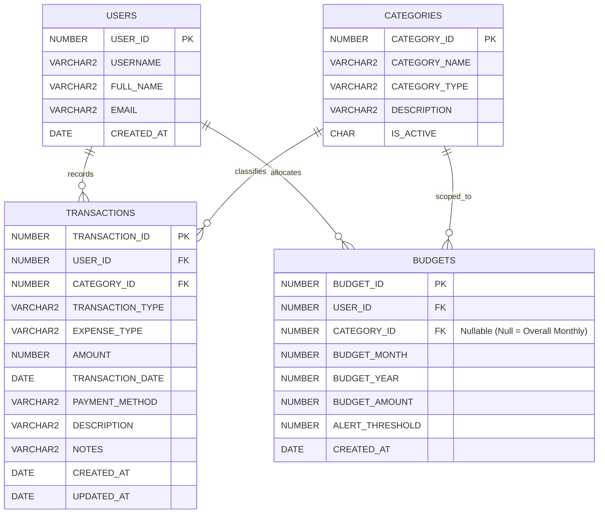

# Smart Expense Tracker with Analytics

A complete, production-grade desktop application built with **Python (Tkinter & ttk)**, **Oracle Database & PL/SQL**, **Pandas**, **NumPy**, **Matplotlib**, and **ReportLab**. Designed as a college-level Python mini-project and financial dashboard.

---

## 📸 Reference UI & Design Aesthetic

The application faithfully recreates the visual design and layout of a modern purple-and-lavender finance dashboard:
- **Clean Purple Theme**: Light slate canvas (`#F7F8FC`), crisp white cards (`#FFFFFF`), vibrant purple branding (`#7C5CFC`), and soft lavender highlights (`#EDE9FE`).
- **Vertical Navigation Sidebar**: Left navigation dock with icons for Dashboard, Transactions, Add Expense, Add Income, Budgets, Analytics, Reports, and Settings.
- **Top Year Filter Bar**: Interactive pill selector (`Select all`, `2017`, `2018`, ..., `2024`) dynamically driving all analytics.
- **Interactive Monthly Area Chart**: 12-month expense/deposit trend with smooth curve and lavender area fill under the line, with Expenses vs Income toggle.
- **2x2 Executive Summary Cards**: Large formatted badges for **Total Deposit** (e.g. `₹710K`), **Total Expenses** (e.g. `₹553K`), **Expense %** (`78%`), and **Saving %** (`22%`).
- **Donut Visualizations**:
  - *Total Expenses by TYPE* (Donut chart: NEED, WANTS, SELF, ANONYMOUS, INVESTMENT).
  - *Total Expenses by Category* (Donut chart: BANK_TRANSFER, HOUSING, FOOD_SUPPLIES, etc.).
- **Category Summary Table**: Formatted hierarchy with descending expense totals and bold summary footer (`₹5,52,810`).
- **Indian Rupee (₹) Formatting**: Standard Indian numbering system (e.g. `₹3,12,719`).

---

## 🛠️ Technology Stack

| Layer | Technologies |
|---|---|
| **Frontend GUI** | Python 3.10+, Tkinter, Custom TTK Styling, Pillow (PIL), Matplotlib (`FigureCanvasTkAgg`) |
| **Database Engine** | **Oracle Database** (Oracle XE 11g/18c/21c/23ai, Autonomous DB) |
| **Database Driver** | `python-oracledb` (Thin mode by default, automatic Thick mode compatibility) |
| **Business Logic** | **PL/SQL Stored Procedures & Functions** for atomic operations & financial aggregation |
| **Data Science & Analytics** | **Pandas** (DataFrame aggregations), **NumPy** (rolling averages & variance) |
| **Reporting & Export** | CSV Spreadsheet Engine, **ReportLab** (Printable PDF Financial Statements) |
| **Configuration** | `python-dotenv` with `.env` and in-app Settings Wizard |

---

## 🗄️ Database Architecture & Entity Relationship Diagram



### Table Specifications
1. **`USERS`**: Manages user profiles.
2. **`CATEGORIES`**: Holds expense and income categories with constraints (`CHECK IN ('EXPENSE', 'INCOME', 'BOTH')`).
3. **`TRANSACTIONS`**: Records monetary flows with check constraints (`AMOUNT > 0`, `TRANSACTION_TYPE IN ('INCOME', 'EXPENSE')`). Indexed on `(USER_ID, TRANSACTION_DATE)` for high-performance reporting.
4. **`BUDGETS`**: Enforces strict monthly budgets. Unique functional index `UIX_BUDGET_SCOPE ON BUDGETS(USER_ID, BUDGET_YEAR, BUDGET_MONTH, NVL(CATEGORY_ID, 0))` prevents duplicate budget allocations.

---

## ⚙️ PL/SQL Stored Procedures & Functions

All database operations are driven directly through Oracle PL/SQL:

1. **`ADD_TRANSACTION`**: Inserts a transaction, validates `AMOUNT > 0`, assigns timestamps, commits atomically, and returns the generated `TRANSACTION_ID` via `OUT NUMBER`.
2. **`UPDATE_TRANSACTION`**: Modifies an existing transaction record with input validation and returns `p_rows_updated`.
3. **`DELETE_TRANSACTION`**: Safely deletes a transaction by ID with row count verification.
4. **`GET_TOTAL_INCOME`**: PL/SQL stored function calculating total income for a given user, year, and optional month.
5. **`GET_TOTAL_EXPENSES`**: PL/SQL stored function calculating total expenses for a selected period.
6. **`GET_MONTHLY_SUMMARY`**: Returns a 12-month summary via Oracle `SYS_REFCURSOR` (`MONTH_NUM`, `MONTH_NAME`, `TOTAL_INCOME`, `TOTAL_EXPENSE`, `NET_SAVINGS`).
7. **`GET_CATEGORY_SUMMARY`**: Aggregates expenses by category via `SYS_REFCURSOR` sorted descending by amount.
8. **`SAVE_BUDGET`**: Upsert procedure that inserts or updates an overall or category-level monthly budget.
9. **`GET_BUDGET_STATUS`**: Returns budget status via `SYS_REFCURSOR` calculating actual spending from real transactions, remaining budget, utilization percentage, and alert status (`OK`, `WARNING`, `EXCEEDED`).

---

## 📁 Project Directory Structure

```
smart_expense_tracker/
│
├── main.py                     # Main application entry point & navigation orchestrator
├── requirements.txt            # Python dependencies
├── README.md                   # Complete documentation & viva reference
├── .env.example                # Example environment configuration
├── .env                        # Active local database credentials
├── .gitignore                  # Git ignore rules
│
├── config/
│   ├── __init__.py
│   └── settings.py             # Theme tokens, font configurations, and environment loader
│
├── database/
│   ├── __init__.py
│   ├── connection.py           # Database connection manager (Thin & Thick mode, PL/SQL caller)
│   ├── initializer.py          # Schema creation & demonstration seed runner
│   ├── schema.sql              # DDL: Tables, constraints, sequences, triggers
│   ├── procedures.sql          # PL/SQL: Stored procedures and functions
│   └── seed_data.sql           # Seed demonstration data matching dashboard visuals
│
├── models/
│   ├── __init__.py
│   ├── transaction_model.py    # Transaction dataclass
│   ├── budget_model.py         # Budget dataclass
│   └── category_model.py       # Category dataclass
│
├── services/
│   ├── __init__.py
│   ├── transaction_service.py  # Wrapper for PL/SQL transaction procedures
│   ├── budget_service.py       # Wrapper for PL/SQL budget procedures
│   ├── analytics_service.py    # Pandas & NumPy statistical analysis
│   └── report_service.py       # CSV and ReportLab PDF statement exporter
│
├── ui/
│   ├── __init__.py
│   ├── theme.py                # TTK styling, color palette, custom widgets
│   ├── components.py           # CardFrame, StatCard, PillSelector, MonthGridSelector
│   ├── dashboard.py            # Reference Dashboard with Matplotlib charts
│   ├── transactions.py         # Transaction management table, search, edit/delete
│   ├── add_transaction.py      # Form for adding expenses and incomes
│   ├── budgets.py              # Budget management and alert tracking
│   ├── analytics.py            # Dedicated analytics page with comparative charts
│   ├── reports.py              # Financial statements, PDF & CSV export
│   └── settings.py             # Database credentials configuration and testing
│
├── utils/
│   ├── __init__.py
│   ├── validators.py           # Amount, date, and text input validations
│   └── formatters.py           # Indian Rupees (₹) and compact metric formatters
│
├── assets/
│   ├── generate_icons.py       # Pillow script for sidebar icons
│   └── icons/                  # 36x36 PNG navigation icons
│
└── tests/
    ├── __init__.py
    ├── test_validators.py      # Unit tests for input validations
    ├── test_calculations.py    # Unit tests for KPI calculations & INR formatters
    └── test_database.py        # Integration tests for live Oracle DB & PL/SQL
```

---

## 🚀 Setup and Installation Guide

### 1. Prerequisites
- **Python**: Version 3.10 or higher.
- **Oracle Database**: Any edition (Oracle Database Express Edition 11g / 18c / 21c / 23ai or Enterprise / Cloud Autonomous Database).
- (Optional for Oracle 11g): **Oracle Instant Client 19+** (automatically auto-detected in `instantclient_19_23` if present).

### 2. Install Python Dependencies
Open PowerShell or Terminal in the project root:
```bash
pip install -r requirements.txt
```

### 3. Configure Database Credentials
Edit `.env` (or configure directly in the application's **Settings** screen):
```ini
ORACLE_USER=expense_tracker
ORACLE_PASSWORD=ExpenseTracker123#
ORACLE_HOST=localhost
ORACLE_PORT=1521
ORACLE_SERVICE_NAME=xe
ORACLE_DSN=localhost:1521/xe

# For Oracle 11g Thick Mode (leave empty for Thin mode on Oracle 12c+)
ORACLE_CLIENT_DIR=instantclient_19_23
```

### 4. Initialize Database Schema & Seed Data
You can initialize the database in **two easy ways**:

#### Method A: From Command Line
Run the built-in database initializer script:
```bash
python -m database.initializer
```
This automatically:
1. Executes `database/schema.sql` (Creates tables, sequences, constraints, triggers).
2. Compiles `database/procedures.sql` (Compiles all 9 PL/SQL procedures and functions).
3. Executes `database/seed_data.sql` (Loads demonstration categories and transactions).

#### Method B: From the Application UI
1. Launch the app: `python main.py`.
2. Go to the **Settings** tab.
3. Click **"Run Schema & Compile PL/SQL"**, then click **"Reload Demonstration Seed Data"**.

---

## 🖥️ Running the Application

Start the desktop dashboard:
```bash
python main.py
```

---

## 🧪 Running Automated Tests

Run the full suite of unit and live Oracle integration tests:
```bash
python -m unittest discover -s tests -p "test_*.py" -v
```

All 14 tests validate:
- Input validators (strict positive amounts, date parsing, budget thresholds).
- Financial math (savings formula, division-by-zero protection, compact and Indian Rupee formatting).
- Real Oracle PL/SQL procedures (`ADD_TRANSACTION`, `UPDATE_TRANSACTION`, `DELETE_TRANSACTION`, `GET_TOTAL_INCOME`, `GET_TOTAL_EXPENSES`, `GET_MONTHLY_SUMMARY`, `GET_CATEGORY_SUMMARY`, `SAVE_BUDGET`, `GET_BUDGET_STATUS`).

---

## 🔍 Troubleshooting Common Oracle Errors

| Error Code | Cause | Solution |
|---|---|---|
| `DPY-3010` | python-oracledb Thin mode does not support Oracle 11g server directly. | Set `ORACLE_CLIENT_DIR=instantclient_19_23` in `.env`. Python-oracledb will automatically run in Thick mode via the Oracle 19 client libraries. |
| `ORA-12541` | TNS: no listener running on host:port. | Ensure `OracleXETNSListener` service is running in Windows Services (`Get-Service *oracle*`). |
| `ORA-01017` | Invalid username/password. | Verify credentials in `.env` or Settings tab. |
| `ORA-20001` | PL/SQL validation failure (`Amount must be > 0`). | The application's PL/SQL procedures enforce positive transaction amounts. |
| `ORA-20003` | PL/SQL validation failure (`Budget must be > 0`). | Budget amounts must be strictly positive. |

---

## 🎓 College Viva & Demonstration Checklist

During project demonstration or viva, you can highlight:
1. **Separation of Concerns**: Clean Model-View-Service architecture (UI never constructs raw SQL).
2. **Security**: Bind variables (`:bind_name`) used in all queries to prevent SQL Injection.
3. **True PL/SQL Integration**: Python does not calculate financial sums locally; it invokes Oracle PL/SQL functions (`GET_TOTAL_INCOME`, `GET_TOTAL_EXPENSES`) and procedures returning `SYS_REFCURSOR`.
4. **Data Science Integration**: Pandas and NumPy compute rolling averages, MoM percentage changes, and distributions embedded directly in Tkinter via Matplotlib.
5. **Report Generation**: One-click export to CSV spreadsheet and printable PDF via ReportLab.
6. Prince Raj (@PrinceRaj-45
) - Developer & Contributor
